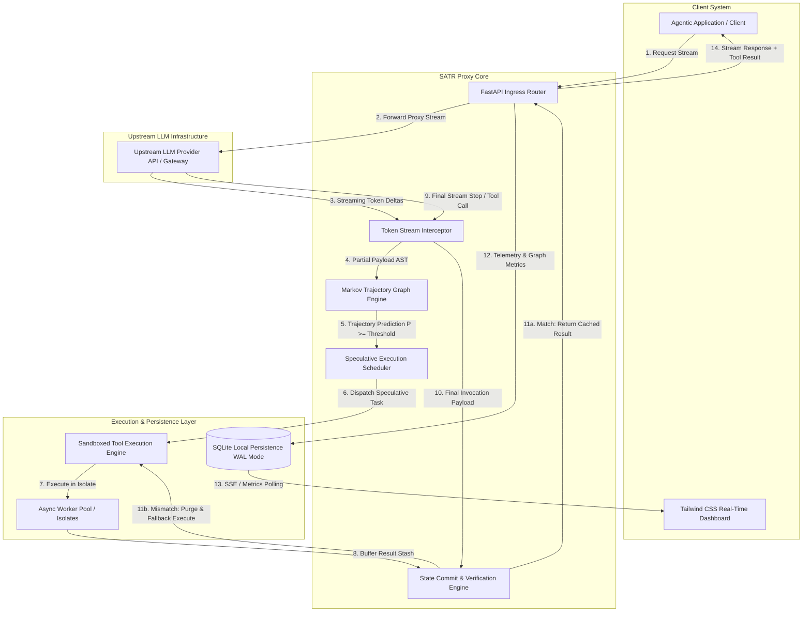
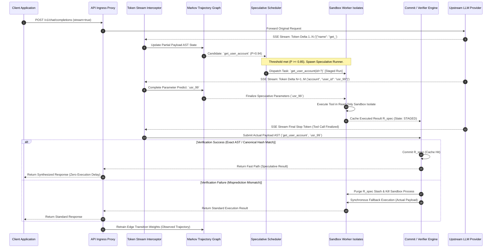
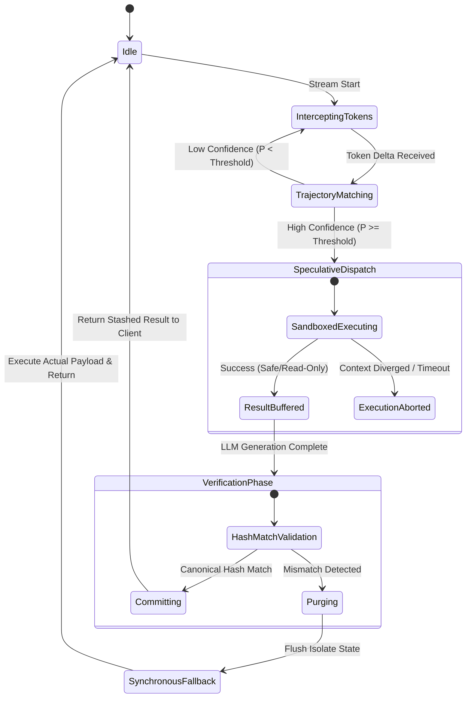

# System Architecture: Speculative Agent Tool Runtime (SATR)

The Speculative Agent Tool Runtime (SATR) is a high-performance middleware architecture designed to eliminate tool-execution latency in Large Language Model (LLM) agent workflows. By intercepting streaming token deltas in real time, SATR matches emerging partial payloads against a dynamic Markov Trajectory Graph (MTG). When a predicted tool invocation path crosses an expected utility threshold, the runtime speculatively pre-executes read-only or sandboxed transactional tools in parallel with ongoing LLM token generation.

---

## 1. High-Level System Topology

SATR operates as a transparent proxy layer positioned between client applications (or API gateways) and upstream LLM providers (e.g., OpenAI, Anthropic, local vLLM instances). 



### Component Breakdown

#### Token Stream Interceptor (TSI)
- **Role**: Intercepts Server-Sent Events (SSE) token streams from upstream LLMs at sub-millisecond overhead.
- **Mechanism**: Maintains a incremental stream-parser AST state machine. Tracks structured JSON schema boundaries (e.g., `tool_calls[i].function.arguments`) without waiting for JSON closure.

#### Markov Trajectory Graph (MTG) Engine
- **Role**: Predicts probable complete tool names and parameter values based on partial token prefixes and historical agent execution paths.
- **Mechanism**: Maintains a directed weighted graph $G = (V, E)$ where nodes represent tool-schema state fragments and edges represent transition probabilities $P(S_{t+1} \mid S_t, Context)$. Employs a dynamic Prefix Trie for fast string-prefix match scanning.

#### Speculative Execution Scheduler (SES)
- **Role**: Decides whether to spawn speculative execution tasks based on calculated Expected Utility:
  $$E[U] = P(\text{match}) \cdot T_{\text{latency\_saved}} - C_{\text{compute\_cost}}$$
- **Mechanism**: Dispatches tasks to the execution engine if $E[U] > \tau$ (configurable confidence threshold). Manages cancellation signals if the stream diverges from predicted trajectories.

#### Sandboxed Tool Execution Engine (STEE)
- **Role**: Safely executes speculative tool tasks in isolated runtime environments.
- **Mechanism**: Categorizes tools into `SAFE_READ_ONLY`, `SANDBOXED_TRANSACTIONAL`, and `MUTATING_SIDE_EFFECT`. Restricts non-deterministic or destructive tools from speculative execution. Uses sub-interpreter/process-level isolation with strict CPU/memory limits.

#### State Commit & Verification Engine (SCVE)
- **Role**: Validates speculative results against the LLM's actual final generated tool call payload.
- **Mechanism**: Performs exact AST matching or canonical SHA-256 parameter hashing (`SHA256(canonical_json(actual)) == SHA256(canonical_json(predicted))`). On match, commits results instantly. On mismatch, purges the speculative isolate and triggers standard fallback execution.

#### Persistence & Audit Engine (SQLite)
- **Role**: Stores graph state, historic trajectory transitions, execution audit logs, and performance metrics.
- **Mechanism**: Operates SQLite in Write-Ahead Logging (WAL) mode with memory-mapped I/O (`PRAGMA journal_mode=WAL; PRAGMA mmap_size=268435456;`).

---

## 2. Tech Stack Rationale

SATR strictly balances production battle-tested stability (70%) with high-performance, cutting-edge techniques (30%).

| Layer / Subsystem | Technology Choice | Stack Category | Architectural Rationale |
| :--- | :--- | :--- | :--- |
| **Language Runtime** | Python 3.11+ | Battle-Tested | Utilizes Task Groups (`asyncio.TaskGroup`), zero-cost exception handling, and core speedups over 3.10. Essential for async streaming proxy performance. |
| **Data Integrity & Schemas** | Pydantic v2 | Battle-Tested | Core Rust-backed validation engine (`pydantic-core`). Delivers up to 20x throughput for schema validation and canonical JSON normalization during token ingestion. |
| **API & Proxy Layer** | FastAPI + Uvicorn | Battle-Tested | Asynchronous ASGI architecture. Native support for high-concurrency SSE streaming, WebSockets, and low-latency proxy routing. |
| **Persistence & Telemetry** | SQLite (WAL Mode) | Battle-Tested | Zero-dependency, file-backed transactional database. High-concurrency reads via WAL, sub-millisecond query latencies for graph weights and audit logs. |
| **Dashboard UI** | Tailwind CSS + Alpine.js | Battle-Tested | Micro-footprint, server-side rendered (Jinja2) or modern SPA interface. Zero heavy Node build chains required for runtime container images. |
| **Stream-Trie Prediction** | Async Token-Trie In-Memory Engine | Bleeding-Edge | Custom in-memory prefix trie integrated with Markov state transitions. Allows continuous partial token delta string-matching in $O(k)$ where $k$ is token length. |
| **Speculative Runtime Isolation** | Async Sub-Process / WASM Sandboxing | Bleeding-Edge | Dynamic execution isolation using Python sub-processes or WASM components (`wasmtime-py`), enforcing copy-on-write memory and zero unauthorized network access. |

---

## 3. Module & Directory Layout

The codebase follows a modular design separating the streaming proxy engine, graph trajectory processing, sandbox isolates, and observability storage.

```
satr-runtime/
├── pyproject.toml
├── README.md
├── ARCHITECTURE.md
├── docker-compose.yml
├── Dockerfile
├── satr/
│   ├── __init__.py
│   ├── main.py                          # Application entry point (FastAPI CLI)
│   ├── config.py                        # Pydantic Settings & Environment Specs
│   │
│   ├── api/                             # Ingress & Egress Ingestion API
│   │   ├── __init__.py
│   │   ├── router.py                    # Main proxy route routing logic
│   │   ├── sse_parser.py                # Zero-copy SSE token delta stream parser
│   │   └── dashboard_routes.py          # Dashboard endpoints & WS streams
│   │
│   ├── engine/                          # Speculative Runtime Core Engine
│   │   ├── __init__.py
│   │   ├── interceptor.py               # Streaming Token Interceptor state machine
│   │   ├── scheduler.py                 # Task Scheduler & Expected Utility calculator
│   │   └── verifier.py                  # Canonical JSON AST Commit/Verification engine
│   │
│   ├── graph/                           # Markov Trajectory Graph Subsystem
│   │   ├── __init__.py
│   │   ├── mtg.py                       # Markov Trajectory Graph engine implementation
│   │   ├── trie.py                      # Concurrent Token Prefix Trie
│   │   └── trainer.py                   # On-line trajectory weight updater
│   │
│   ├── sandbox/                         # Execution Sandboxing Subsystem
│   │   ├── __init__.py
│   │   ├── runner.py                    # Async Worker Pool manager
│   │   ├── classification.py            # Tool safety categorizer & decorator
│   │   ├── isolates/                    # Process and WASM boundary isolates
│   │   │   ├── __init__.py
│   │   │   ├── process_isolate.py       # Restricted OS process executor
│   │   │   └── memory_cow.py            # In-memory Copy-on-Write state buffer
│   │   └── tools/                       # Tool registry interface definitions
│   │       ├── __init__.py
│   │       └── registry.py              # Dynamic tool definition & schema loader
│   │
│   ├── db/                              # Local Storage Layer
│   │   ├── __init__.py
│   │   ├── session.py                   # SQLite connection manager & WAL config
│   │   ├── models.py                    # Pydantic / ORM persistence definitions
│   │   └── repository.py                # Graph node & audit metric queries
│   │
│   └── dashboard/                       # Telemetry Web UI
│       ├── templates/                   # Jinja2 HTML Dashboard Views
│       │   └── index.html
│       └── static/                      # Compiled Tailwind CSS assets & Alpine scripts
│           ├── css/
│           │   └── main.css
│           └── js/
│               └── dashboard.js
└── tests/
    ├── unit/
    │   ├── test_sse_parser.py
    │   ├── test_trie.py
    │   ├── test_mtg.py
    │   └── test_verifier.py
    ├── integration/
    │   ├── test_proxy_pipeline.py
    │   └── test_sandbox_isolation.py
    └── benchmarks/
        └── test_speculative_latency.py
```

---

## 4. Data Flow & Component Interaction Pipeline

### Execution Sequence Diagram



### State Machine Lifecycle



---

## 5. Security & Boundary Isolation

Executing speculative operations based on predictive heuristics introduces security challenges regarding data leaks, unauthorized side-effects, and compute resource depletion. SATR enforces a layered isolation architecture.

```
               [ Incoming LLM Partial Speculation ]
                               │
                               ▼
               ┌───────────────────────────────┐
               │   Tool Safety Classifier      │
               └───────────────┬───────────────┘
                               │
         ┌─────────────────────┼─────────────────────┐
         ▼                     ▼                     ▼
┌─────────────────┐   ┌─────────────────┐   ┌─────────────────┐
│ SAFE_READ_ONLY  │   │ TRANSACTIONAL   │   │ MUTATING_EFFECT │
└────────┬────────┘   └────────┬────────┘   └────────┬────────┘
         │                     │                     │
         ▼                     ▼                     ▼
┌─────────────────┐   ┌─────────────────┐   ┌─────────────────┐
│ Immediate       │   │ Copy-on-Write   │   │ BLOCK           │
│ Speculative     │   │ Memory Staging  │   │ Speculation.    │
│ Execution       │   │ Isolation       │   │ Wait for LLM.   │
└─────────────────┘   └─────────────────┘   └─────────────────┘
```

### Tool Safety Taxonomy

SATR categorizes every registered agent tool into one of three execution policies:

1. **`SAFE_READ_ONLY`**:
   - Operations that query data without altering global state (e.g., `get_user_profile`, `search_knowledge_base`, `fetch_weather`).
   - **Speculation Policy**: Fully enabled for speculative pre-execution.

2. **`SANDBOXED_TRANSACTIONAL`**:
   - Operations that mutate state within an isolatable, rollback-capable context (e.g., SQLite in-memory savepoint, staging git commits, draft message creation).
   - **Speculation Policy**: Allowed under strict Copy-on-Write (CoW) memory boundaries. Mutations are staged in transient volatile buffers. If the trajectory is aborted, the volatile state is discarded instantly without touching system storage.

3. **`MUTATING_SIDE_EFFECT`**:
   - Operations with external non-reversible real-world consequences (e.g., `send_email`, `charge_credit_card`, `delete_database`, `execute_wire_transfer`).
   - **Speculation Policy**: **STRICTLY PROHIBITED**. The speculative engine bypasses prediction for these nodes. Execution remains blocked until the LLM completes generation and the payload is validated.

### Sandbox Runtime Isolation Mechanics

Speculative tasks run inside isolated environments enforced by the `satr.sandbox.isolates` module:

```python
# Conceptual Architecture of Sandbox Boundary Settings
class IsolatesConfiguration(BaseModel):
    max_memory_bytes: int = 128 * 1024 * 1024  # 128 MB strict limit
    cpu_time_limit_ms: int = 350               # 350 ms execution cutoff
    network_egress_allowlist: list[str] = []   # Restricted host domain list
    enable_seccomp_bpf: bool = True            # Block unauthorized Linux syscalls
    prevent_filesystem_write: bool = True      # Read-only rootfs mount
```

- **Process-Level Hardening**: Speculative tasks are spawned in sub-processes utilizing Linux `seccomp-bpf` profile filters. System calls modifying file system structures (`unlink`, `chmod`, `rmdir`, `write` on non-staged descriptors) are intercepted and rejected (`EPERM`).
- **Resource Depletion Defense**: A strict hard execution timeout (default: $350\text{ ms}$) terminates speculative workers automatically. If memory consumption exceeds $128\text{ MB}$, OS OS cgroup triggers SIGKILL, preventing Denial of Service (DoS) attacks via infinite speculative recursion.
- **Resource Reclamation**: Uncommitted or mispredicted speculative task buffers are collected by an explicit Async Task Cleanup Manager that purges staging buffers, cancels pending futures, and recycles process isolates back into the execution pool.